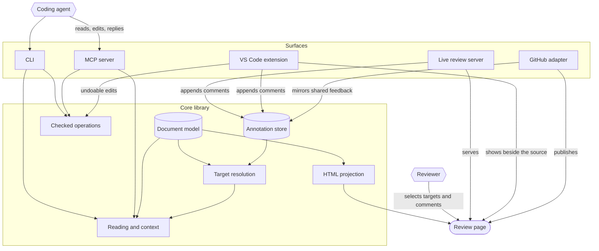

<!-- htmi:document htmi-architecture -->

# HTMi architecture

HTMi is a library with six thin surfaces on top: a CLI, a local review server,
a VS Code extension, a Chrome extension for github.com, a GitHub adapter and an
MCP server. There is no hosted service
and no database. Source documents stay where they are and stay authoritative: an
HTML document is its HTML file, a Markdown document its Markdown file, a
description its text on GitHub. Feedback is a JSONL file in the repository and,
when shared, ordinary GitHub issue comments.

This file is itself a HTMi document. Run `htmi targets htmi-architecture` in
this repository to see its commentable parts.

## Components

| Module                               | Responsibility                                                                                                                                        | Not responsible for                                     |
| ------------------------------------ | ----------------------------------------------------------------------------------------------------------------------------------------------------- | ------------------------------------------------------- |
| `src/core/markdown.ts`, `mermaid.ts` | Sections, fences, alerts; the supported flowchart subset with character spans                                                                         | Rendering                                               |
| `src/core/document.ts`, `html.ts`    | Sections, blocks, targets, identity, full-content digests, assets, coverage                                                                           | Guessing meaning that is not written down               |
| `src/core/reading.ts`                | Outline, section, block and search reads for agents                                                                                                   | Being a second source of truth                          |
| `src/core/html-edit.ts`              | HTML edits as splices at parse5 offsets                                                                                                               | Serialising the tree back                               |
| `src/core/annotations.ts`            | Event schema, append, fold into threads, agent restrictions                                                                                           | Deciding what a comment means                           |
| `src/core/resolve.ts`                | Where a comment's target is now                                                                                                                       | Choosing between candidates                             |
| `src/core/context.ts`                | The packet an agent reads                                                                                                                             | Claiming omitted material is irrelevant                 |
| `src/core/operations.ts`             | Targeted edits with preconditions and a side-effect check                                                                                             | Arbitrary rewrites                                      |
| `src/render/html-projection.ts`      | The authored page in the passive view, assets embedded, CSS scoped                                                                                    | Running anything the author wrote                       |
| `src/render/*`                       | Layout (dagre), SVG, review page, browser client                                                                                                      | Holding credentials                                     |
| `src/server/serve.ts`                | Local live mode; the original in a CSP sandbox                                                                                                        | Editing documents                                       |
| `vscode/src/extension.ts`            | The page beside the editor, show in source, operations as WorkspaceEdits                                                                              | Writing files behind the editor's back                  |
| `chrome/src/content.ts`, `viewer.ts` | On github.com: reads files and descriptions with the session, builds the page with the core in a sandboxed extension page, fills GitHub's comment box | Holding a token or posting anything                     |
| `src/github/github.ts`               | Issue artifacts, issue comments, mirroring                                                                                                            | Tokens (gh owns them)                                   |
| `src/github/description.ts`          | Issue and pull request descriptions as Markdown documents; re-read before a write                                                                     | A conditional write GitHub does not offer               |
| `src/mcp/server.ts`                  | Seven tools over the shared actions                                                                                                                   | Resolving comments                                      |
| `src/app/documents.ts`               | Opening any document: files through the core, descriptions through GitHub                                                                             | Fetching anything the caller did not name or comment on |
| `src/app/actions.ts`                 | Operations shared by the CLI and MCP                                                                                                                  | Formatting                                              |
| `src/app/review-api.ts`              | Comment and reply writes shared by the live server and VS Code                                                                                        | Trusting what the page sends                            |

## Identity

A target id is never a label, a screen position or a renderer id.

| Target       | Id                                                | Mapping                                               |
| ------------ | ------------------------------------------------- | ----------------------------------------------------- |
| Diagram      | `%% htmi:diagram <id>`                            | exact; derived from the section when missing (warned) |
| Component    | `n.<mermaid node id>`                             | exact: the author wrote the id                        |
| Connection   | `%% htmi:edge <id>` before the edge               | exact; otherwise `e.<from>.<to>[.n]`, derived         |
| Group        | `g.<subgraph id>`                                 | exact when the subgraph has an id                     |
| Image        | `img.<section>.<file stem>[.n]`                   | derived                                               |
| Text         | `t.<section>` plus a quote with prefix and suffix | heuristic by nature                                   |
| HTML element | its authored `id`, as `#id`                       | exact; a duplicated id is ambiguous                   |
| HTML element | `data-doc-target` attribute                       | exact                                                 |
| HTML block   | `b.<section>.p1`, `b.<section>.table1` and so on  | derived: moves when blocks are inserted               |
| Description  | `github:owner/repo#7`                             | the document; targets inside it as for Markdown       |

Digests cover what gives a target its meaning and nothing about layout. For a
diagram part: label, shape, endpoints, edge label, style, description, icon bytes,
group membership, so reordering statements changes no digest and renaming one
component changes one. For an HTML element: its full text and structure and the
bytes of the files it uses, never a shortened label, so a cost changed after a
long introduction is a change.

## Data flow of one review

1. A reviewer selects a target in the review page (in the browser or beside the
   source in VS Code) and writes a comment. In live
   mode the server checks the document digest, resolves the target, and appends a
   `comment` event. In snapshot mode the page prepares a GitHub comment that the
   reviewer posts; `htmi github pull` mirrors it.
2. An agent runs `htmi context <doc> --comment <id>` (or the MCP tool) and gets the
   comment verbatim with exactly the context it needs.
3. The agent changes the source with `htmi apply`, which checks both digests,
   re-parses, and refuses the edit if any other target would change.
4. The agent replies with status `addressed` and the revision. Only a person can
   mark the thread `resolved`.
5. Resolution runs again on every read: the comment is reported as exact, changed,
   heuristic, ambiguous or orphaned. It is never moved silently.

## Storage

| Data                | Authority                    | Notes                                                    |
| ------------------- | ---------------------------- | -------------------------------------------------------- |
| Documents           | Git files                    | HTMi writes only through `htmi apply` or a WorkspaceEdit |
| Descriptions        | GitHub                       | read and written through `gh`; re-read before a write    |
| Local feedback      | `.htmi/annotations.jsonl`    | append-only; `htmi init` sets `merge=union`              |
| Shared feedback     | GitHub issue comments        | mirrored by comment id                                   |
| Published snapshots | GitHub issue artifacts       | `.htmi/github.json` records what HTMi last wrote         |
| Drafts in the page  | browser storage when allowed | labelled as kept in this browser only                    |

## Trust boundaries

- Rendered pages hold no credentials. GitHub calls go through `gh`.
- Comment bodies, labels and imported metadata are data. Imported metadata is
  schema-checked; authorship comes from the host, never from the body.
- The review page has a Content-Security-Policy with exact hashes. In snapshot mode
  it cannot make network requests.
- The live server binds to 127.0.0.1, checks the Host header and requires a per-run
  token on writes.
- The review view never runs what the author wrote. The original is served under a
  CSP sandbox with an opaque origin, so its scripts cannot read HTMi's pages or
  pass the write checks; only documents' folders and the files they use are
  served, never `.git` or `.htmi`.
- The Chrome extension builds the review page inside a sandboxed extension page
  (opaque origin, no network, no extension APIs). The content script on github.com
  only fetches what GitHub's own pages fetch, with the signed-in session, and puts
  prepared text into GitHub's comment box; the person posts it.
- Element keys in the view carry a nonce that is fresh per build, so attributes an
  author wrote cannot stand in for HTMi's.
- Document, asset and source paths are confined to the repository, including through
  symlinks (`confinedPath` in `src/core/revision.ts`). A document is checked when it is
  read and again at the moment an edit is written.
- `git` and `gh` run with a minimal environment (`src/core/env.ts`): system basics,
  locale, temporary and XDG folders, proxy and certificate settings, `GH_*`,
  `GITHUB_TOKEN` and `GIT_*`. Secrets in the caller's environment are not passed on.
- The Hermes plugin works on GitHub only in the repository's origin and the repositories
  the person lists, and Hermes asks the person before each issue it creates and each
  description it replaces or edits (`hermes/policy.py`, a `pre_tool_call` hook).
- Inline icons are reduced to plain geometry; anything else is embedded as an image,
  where browsers run no script.
