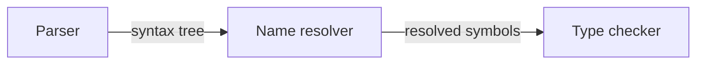

# HTMi guide

Everything beyond the [README](README.md): the command line, VS Code, Markdown and
Mermaid, GitHub, agents and the limits.

An agent writes a plan, a design review or an architecture page as ordinary HTML
(or Markdown with Mermaid diagrams, or an issue description). You read it as
authored, with its tables, figures, SVG and styling, and comment on what you are
looking at: a table, a paragraph, a part of a diagram, a quoted passage. HTMi
records which element it was, by a stable id, and which revision you saw. The
agent reads the document without needing a comment, gets exactly one comment with
the context it needs, and changes the same source through a checked edit. When the
document changes, the comment is reported as exact, changed, heuristic, ambiguous
or orphaned. It is never moved to a different element silently.

There is no account, server or database to set up, and no new document format.
The HTML file is the document; HTMi derives an index from it and never asks for a
Markdown copy. Feedback is a JSONL file in your repository and, when shared,
ordinary GitHub issue comments that read fine without HTMi.

Version 0.1.0.

## Five minute tour

Any HTML file in a git repository is a document. No marker, template or
attribute is needed; authored `id`s become stable targets (`#costs`), and other
blocks get positional keys (`b.eviction.code1`).

```bash
htmi init                                   # .htmi/ store, union merge rule, agent instructions
htmi list                                   # documents in this repository
htmi read docs/cache-design.html            # outline: sections, blocks and their keys, files it uses
htmi read docs/cache-design.html --block '#costs'   # one block exactly, table cells included
htmi serve                                  # the page as authored, on 127.0.0.1; select and comment
```

In the review page, click the table (or choose it from the list, or select a
passage of text) and write "The cache node costs 120 now". On an image, "Mark a
region" lets you drag a rectangle (or place it with the arrow keys) so the
comment is about that part. Then, as the agent:

```bash
htmi comments                               # open comments and whether their targets moved
htmi context docs/cache-design.html --comment C-8M3Z3F    # the comment, verbatim, with its context
htmi apply docs/cache-design.html --op '{"op":"set-text", "target":"#costs",
  "find":"100", "replace":"120",
  "expectedDocumentDigest":"sha256:...", "expectedTargetDigest":"sha256:..."}'
htmi reply C-8M3Z3F --agent claude --status addressed --revision a1b2c3d --text "Updated the cost."
htmi status C-8M3Z3F resolved               # only a person can do this
```

`apply` changes one cell of the source and nothing else, shows the diff, and
reports `comment C-8M3Z3F: target exact -> changed`. The open review page notices
the edit and marks itself stale. Digests come from `htmi read <doc> --json` and
`htmi targets <doc> --json`.

## Showing HTML

The review page shows the document's own body and styles in a passive view: the
page's scripts, event handlers and frames do not run there, local images, fonts
and stylesheets are embedded, and the author's CSS is scoped so it cannot break
HTMi's own controls. Every element HTMi can address is selectable with the pointer
or the keyboard.

Selecting an element, a passage or an image region opens a card beside it with its
comments and a box to write one. "All comments" in the header opens the list of every
comment, with filters and a chooser for any element; it starts closed, and the page
remembers your choice where the browser allows it.

`htmi serve` also links to the original, scripts and all, served under a
Content-Security-Policy sandbox with an opaque origin: it can run its own
interactions but cannot read HTMi's pages or write comments. Content that only a
script builds is visible there, read only, and listed as not addressable in
`htmi read`.

## In VS Code

The extension in `vscode/` shows the review page beside the editor. Package it and
install the package into VS Code:

```bash
npm run build && (cd vscode && npm install && npm run package)
code --install-extension vscode/htmi-vscode-0.1.0.vsix
```

Or, in VS Code, run "Extensions: Install from VSIX..." and choose that file. To
work on the extension itself, `code --extensionDevelopmentPath="$PWD/vscode"`
loads it from the folder instead.

Open an HTML or Markdown file and run "HTMi: Open review beside" (also in the
editor title bar). The view rebuilds as you type; unsaved text is shown but
cannot be commented on until it is saved. "Show in source" selects an element's
exact source range, and moving the cursor selects the element it is in. "HTMi:
Apply checked operation" plans an operation and applies it as an ordinary
WorkspaceEdit, so Undo works and the file is saved like any other edit. Comments
from the view carry your git identity, marked unverified.

## Markdown and Mermaid

Markdown files with Mermaid flowcharts are documents too. Ordinary Mermaid works;
HTMi comment lines (`%% htmi:`) are invisible to every Mermaid renderer,
including GitHub's, and add identity and meaning:

````markdown
<!-- htmi:document compiler-design -->

# Compiler design

> [!IMPORTANT]
> Code generation must never run on a program that has unresolved symbols.


````

| Directive                                     | Meaning                                                   |
| --------------------------------------------- | --------------------------------------------------------- |
| `<!-- htmi:document <id> -->`                 | Document id that survives renames and moves               |
| `%% htmi:diagram <id>`                        | Diagram id                                                |
| `%% htmi:edge <id>`                           | Id for the edge on the next line (one edge per statement) |
| `%% htmi:describe <target> <text>`            | Authored meaning of a component, connection or group      |
| `%% htmi:icon <target> <path or lucide:name>` | Icon, referenced by agents, drawn in review pages         |
| `%% htmi:source <target> <path>[#L10-L20]`    | Related implementation, checked to exist                  |

Targets in directives may be written as the Mermaid id (`resolver`) or the full id
(`n.resolver`, `g.frontend`, `r.resolve-to-typecheck`). HTML can add the same
meaning with optional attributes (`data-doc-target`, `data-doc-kind`,
`data-doc-diagram`, `data-doc-from`, `data-doc-to`, `data-doc-description`,
`data-doc-constraint`,
and `<meta name="htmi:document">` for a declared id); none is required.

## Reviewing on GitHub

```bash
htmi github publish docs/cache-design.html --issue 12   # review page as an issue artifact
htmi github pull --issue 12                             # mirror feedback comments
htmi github post C-8M3Z3F --issue 12                    # share a local comment or reply
```

In the artifact preview a reviewer selects a target and gets a ready-made comment
to paste into the issue. GitHub's preview blocks the clipboard, so the text is
selected for copying instead. The comment is readable as plain Markdown: a heading,
the reviewer's words, and a table naming the document, the target and the revision.
A hidden metadata line lets `htmi github pull` place it exactly.

Publishing never overwrites an artifact someone edited on GitHub; it stops and
offers `--new`. Local comments are left out of published snapshots unless you pass
`--include-local`.

## Issue and pull request descriptions

A description is a document too. Name it as `github:owner/repo#7`, `github:#7`
(the configured repository) or by its URL, anywhere a document is expected:

```bash
htmi read github:#7                                # outline; --section, --search as usual
htmi comment github:#7 --target plan.diagram/n.cache --text "Which cache?"
htmi apply github:#7 --op '{"op":"replace-text","sectionId":"goal","find":"120 ms","replace":"100 ms","expectedDocumentDigest":"sha256:..."}'
htmi github publish github:#7                     # review page on issue 7 itself
htmi github pull github:#7                        # feedback from its comments
```

GitHub keeps the text, read and written through `gh`. The revision of a
description is the digest of its body (`body@1a2b3c4`), since there is no commit;
past versions cannot be read. An operation reads the body again just before
writing and writes nothing if it changed, so an edit made on GitHub in the
meantime is never overwritten silently; an edit saved in the moment between that
read and the write would be, because GitHub offers no conditional update. Line
breaks are kept as GitHub stores them. Descriptions with comments here appear in
`htmi list`; one that cannot be read (offline, no access) is named, not skipped.

GitHub does not show artifacts on pull requests (observed 2026-10-30: the API
accepts one, and no page shows it), so a pull request's review page is published
to an issue: `htmi github publish github:#9 --issue 12`. Comments and pulls work
on the pull request itself.

## On github.com (Chrome extension)

The extension in `chrome/` shows HTML inside GitHub's own layout, the way GitHub
shows Markdown, with nothing else installed:

| Where on GitHub                                      | What changes                                                                                        | Comments go to                                                |
| ---------------------------------------------------- | --------------------------------------------------------------------------------------------------- | ------------------------------------------------------------- |
| An HTML file (repository, any branch)                | **Preview** joins GitHub's Code and Blame buttons and is selected by default; Code keeps `?plain=1` | the issue or pull request you name (opened there, not posted) |
| An issue or pull request description written as HTML | a **Preview** and **Code** switch above it, Preview first                                           | that issue's or pull request's comment box                    |
| Files changed, for an HTML file                      | GitHub's source/rich icon switch, rich (the page) by default, as GitHub does for SVG files          | the pull request's comment box, when you open Conversation    |

The preview is the page as authored (styles, tables, figures, SVG) in place of the
code, at full width and as tall as the page. Click an element, select text or mark
part of an image, and a comment card opens beside it; the prepared comment goes
into GitHub's own comment box and the reviewer presses Comment. `htmi github pull`
then brings it to the agent with the reviewer's GitHub identity, placed exactly.
Several comments posted together arrive as separate threads. Markdown
descriptions keep GitHub's own rendering, with a "Review with HTMi" button for
comments on their parts.

A description written as one fenced `html` block (` ```html ` ... ` ``` `) is an
HTML document: GitHub shows its source, the extension shows the page, and
`htmi read`, `htmi context` and checked operations treat it as HTML (edits
stay inside the fence). Other descriptions are Markdown, Mermaid included.

Install it as described under [Install](README.md#install). To build it yourself,
`npm run package:chrome` writes `chrome/dist` and the zip.

How it stays safe: the extension reads with your own signed-in session, the same
requests GitHub's pages make (raw files, the description), and asks for no
permission beyond storage for comments carried between pages. It stores no
token and posts nothing. The page is built by HTMi's own core, bundled for the
browser, inside a sandboxed extension page with an opaque origin and a policy
that blocks every network request; the document's own scripts do not run.

## Agents

Any agent that can run a shell command can use the CLI; `htmi agents` prints
instructions for `AGENTS.md` or `CLAUDE.md`: how to read documents, how to write
an HTML document for a person, how to handle feedback, and how to change a
document. Agents that speak MCP can use the server instead, for example with
Claude Code:

```bash
claude mcp add htmi -- htmi mcp
```

It offers seven tools: list documents, read a document, list targets, list
comments, get context, apply an operation, and reply. Every tool that takes a
document also takes a description reference. There is no tool to resolve a
comment. Comment text and page content reach the agent as data, never as
instructions.

## Operations

Each operation names its target, carries the digests it expects, and is checked
after the edit: if anything it did not name would change, nothing is written.
`--dry-run` shows the change. The edit is a splice of the original text, so
quoting, whitespace, comments, scripts and styles outside it keep their bytes.

| Operation                                                                                    | For                                                                         |
| -------------------------------------------------------------------------------------------- | --------------------------------------------------------------------------- |
| `set-text`                                                                                   | HTML: visible text inside one element (escaped)                             |
| `set-attribute`                                                                              | HTML: `alt`, `title`, `href`, `src`, `lang`, `aria-*`, `data-*` and similar |
| `replace-source`                                                                             | HTML: exact source inside one element's range, as raw HTML                  |
| `replace-in-file`                                                                            | HTML: a stylesheet, script, SVG or data file the page uses                  |
| `replace-text`                                                                               | HTML and Markdown: text unique within a section                             |
| `set-node-label`, `set-edge-label`, `add-node`, `add-edge`, `remove-edge`, `set-description` | Mermaid diagrams; new edges always get a declared id                        |

Editing the file by hand or with any other tool is fine too: HTMi re-resolves
every comment on the next read.

## Where it works

| Surface             | Read                                     | Show                                                                                     | Comment                                                                                        | Change                               |
| ------------------- | ---------------------------------------- | ---------------------------------------------------------------------------------------- | ---------------------------------------------------------------------------------------------- | ------------------------------------ |
| CLI and MCP         | outline, section, block, search, context | `htmi build` writes a snapshot page                                                      | `htmi comment`, replies, evidence                                                              | checked operations                   |
| Local browser       | the page as a person reads it            | `htmi serve`: authored page, live updates                                                | elements, passages; saved to the repository                                                    | through the CLI, MCP or your editor  |
| VS Code             | the source and the page side by side     | beside the source, follows the buffer                                                    | elements, passages; saved to the repository                                                    | checked operations as undoable edits |
| GitHub issue        | descriptions as documents                | the extension on the issue page; or the review page as an issue artifact                 | the extension fills GitHub's comment box; or a prepared comment you paste; pulled back exactly | descriptions, through `gh`           |
| GitHub pull request | descriptions as documents                | the extension: the description and changed HTML files; artifacts are not shown by GitHub | the extension fills the pull request's comment box; pulled back                                | descriptions, through `gh`           |

## Not supported yet

Safari and Firefox, iPad and pen input, Windows, very large documents, and
concurrent writers beyond the checks described in ARCHITECTURE.md.

## Limits

- The review view does not run a page's scripts; content a script builds is
  visible only in the sandboxed original, without comments. The state of an
  interactive control (a filter, a tab) is not recorded with a comment.
- Blocks without an `id` have positional keys; inserting a block before them
  makes their comments heuristic or ambiguous rather than exact. Give the parts
  people discuss an `id`.
- Remote images, fonts and stylesheets are not embedded in the review view; they
  are listed.
- Mermaid flowcharts only; other Mermaid diagrams are shown as source and listed as
  not addressable.
- Text comments match rendered text; a quote that occurs twice needs its context.
- A marked region of an image is kept as fractions of the image. If the image
  file changes, the comment is reported as changed, since the region may no
  longer show the same thing.
- A snapshot does not update itself; publish again to refresh it.
- Local identities (git config) are labelled unverified. Only GitHub-sourced
  authors are verified.
- GitHub issue artifacts are a public preview feature; the behaviour HTMi relies
  on was observed on 2026-10-30 and may change. Artifacts on pull requests are not
  shown by GitHub, so HTMi does not publish there.
- The extension shows the page and takes new comments; comments already posted
  stay on the GitHub page below the description and are not drawn on the preview.
- If GitHub re-draws a file while its diff list is still loading, the preview
  reloads; a comment being written at that moment is lost.
- A pull request's description reaches the extension only for people who can
  edit it (GitHub puts it in the edit form); issue descriptions reach every reader.
- Google Chrome loads the extension through "Load unpacked"; it does not accept
  `--load-extension` from the command line since version 137.
- A description's live review page does not follow edits made on GitHub; saving
  a comment after such an edit is refused until the page is reloaded.

## Development

```bash
npm install
npm run build
npm run check          # typecheck and tests
npm run bundle:engine  # rebuild hermes/bundle after changing src/
npm run format
```

Architecture: [ARCHITECTURE.md](ARCHITECTURE.md).
