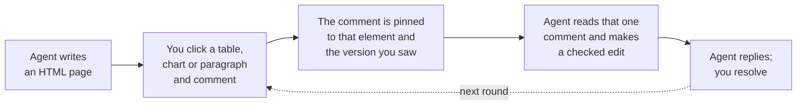

<p align="center"></p>

# HTMi

Your coding agent writes a page. You comment on the exact part you mean. The agent
changes that part and replies.



It works where you already are: the Hermes dashboard, VS Code, the browser, and GitHub
issues and pull requests. No account and no server. Comments are a file in your
repository, or ordinary GitHub comments.

## Install

Each part installs in one step, needs no account or server, and touches nothing outside
its own folder. Your documents stay ordinary files; comments go in `.htmi/` in the
repository.

**Hermes Agent**

```sh
hermes plugins install Thamirawaran/htmi/hermes --enable
```

If Hermes is already running, restart it once with `hermes gateway restart`. Then ask
Hermes for a page to review. Remove it with `hermes plugins remove htmi`. It needs Hermes
0.23 or newer and git; Hermes provides Node.

**Chrome, for GitHub**

1. Download `htmi-chrome-0.1.0.zip` from the
   [latest release](https://github.com/Thamirawaran/htmi/releases/latest) and unzip it.
2. Open `chrome://extensions` and turn on **Developer mode**.
3. Choose **Load unpacked** and pick the unzipped folder.

It runs only on github.com and asks for no permission beyond storage. Remove it with
**Remove** on the same page.

**Command line, for any agent**

```bash
git clone https://github.com/Thamirawaran/htmi && cd htmi
npm install && npm run build && npm link   # puts `htmi` on your PATH
```

It needs Node 20.11 or later. GitHub features use the GitHub CLI (`gh auth login`).
`lucide:` icons need the optional `lucide-static` package in your project.

## Try it with Hermes

1. In a git repository, ask Hermes: "Write the cache plan as an HTML page I can review."
2. Open the **Review** tab in the Hermes dashboard. Click any element and write a comment.
3. Tell Hermes: "Take care of my comments." It edits exactly what you pointed at and
   replies.

To share it, ask Hermes to publish the page as an issue or as a pull request description.
With the Chrome extension, everyone sees the page on GitHub and comments with GitHub's own
Comment button; Hermes brings those comments back.

## Learn more

- [Guide](GUIDE.md): the command line, VS Code, Markdown and Mermaid, GitHub, agents,
  limits
- [Hermes plugin](hermes/README.md): tools, what it does on your computer
- [Architecture](ARCHITECTURE.md)
- [Privacy](PRIVACY.md): HTMi collects nothing

## License

MIT, see [LICENSE](LICENSE).
