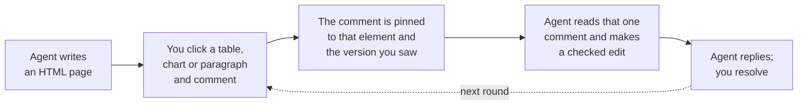

<p align="center"></p>

# HTMi

Review your coding agent's HTML pages, and comment on the exact part you mean.

## Why

Markdown is fine for text, but architecture, data flows and numbers are hard to see in it.
So coding agents increasingly write HTML pages instead: a diagram of the change, charts,
a table of options, a review guide for a pull request.

HTMi makes those pages reviewable. You read the page as it was designed, then ask a
question or disagree right on the element: a chart, a table row, a step in a diagram. Your
agent gets exactly that comment with its context, changes that part, and replies. The
comment stays pinned to its element, and to the version you saw, through every edit.



It works where you already are: in Hermes Agent, Claude Code, Codex or any agent that
speaks MCP, in GitHub issues and pull requests through the Chrome extension, and in VS
Code. No account and no server. Comments are a file in your repository, or ordinary
GitHub comments.

## Install

Each part installs in one step, needs no account or server, and touches nothing outside
its own folder. Your documents stay ordinary files; comments go in `.htmi/` in the
repository.

**Hermes Agent**

```sh
hermes plugins install Thamirawaran/htmi/hermes --enable
```

If Hermes is already running, restart it once with `hermes gateway restart`. Then ask
Hermes for a page to review. Remove it with `hermes plugins remove htmi`. It needs Hermes
0.23 or newer and git; Hermes provides Node.

**Chrome, for GitHub**

1. Download `htmi-chrome-0.1.0.zip` from the
   [latest release](https://github.com/Thamirawaran/htmi/releases/latest) and unzip it.
2. Open `chrome://extensions` and turn on **Developer mode**.
3. Choose **Load unpacked** and pick the unzipped folder.

It runs only on github.com and asks for no permission beyond storage. Remove it with
**Remove** on the same page.

**Claude Code, Codex and other agents**

```bash
git clone https://github.com/Thamirawaran/htmi && cd htmi
npm install && npm run build && npm link   # puts `htmi` on your PATH
```

Then connect your agent to HTMi's MCP server:

```bash
claude mcp add htmi -- htmi mcp            # Claude Code
```

```toml
# Codex: ~/.codex/config.toml
[mcp_servers.htmi]
command = "htmi"
args = ["mcp"]
```

In your repository, run `htmi init` once. It sets up `.htmi/` and prints short
instructions to paste into `CLAUDE.md` or `AGENTS.md`. It needs Node 20.11 or later;
GitHub features use the GitHub CLI (`gh auth login`).

**VS Code:** the extension is in [`vscode/`](GUIDE.md#in-vs-code); the Marketplace release
is coming.

## Try it

**With Hermes**

1. In a git repository, ask Hermes: "Write the cache plan as an HTML page I can review."
2. Open the **Review** tab in the Hermes dashboard. Click any element and write a comment.
3. Tell Hermes: "Take care of my comments." It edits exactly what you pointed at and
   replies.

**With Claude Code or Codex**

1. Ask: "Write the cache plan as an HTML page in docs/ that I can review."
2. Run `htmi serve`, open the page from the link it prints, and comment on any element.
3. Ask: "Take care of my HTMi comments."

To share a page, ask your agent to publish it as an issue or as a pull request
description. With the Chrome extension, everyone sees the page on GitHub and comments with
GitHub's own Comment button; your agent brings those comments back.

## Learn more

- [Guide](GUIDE.md): the command line, VS Code, Markdown and Mermaid, GitHub, agents,
  limits
- [Hermes plugin](hermes/README.md): tools, what it does on your computer
- [Architecture](ARCHITECTURE.md)
- [Privacy](PRIVACY.md): HTMi collects nothing

## License

MIT, see [LICENSE](LICENSE).
